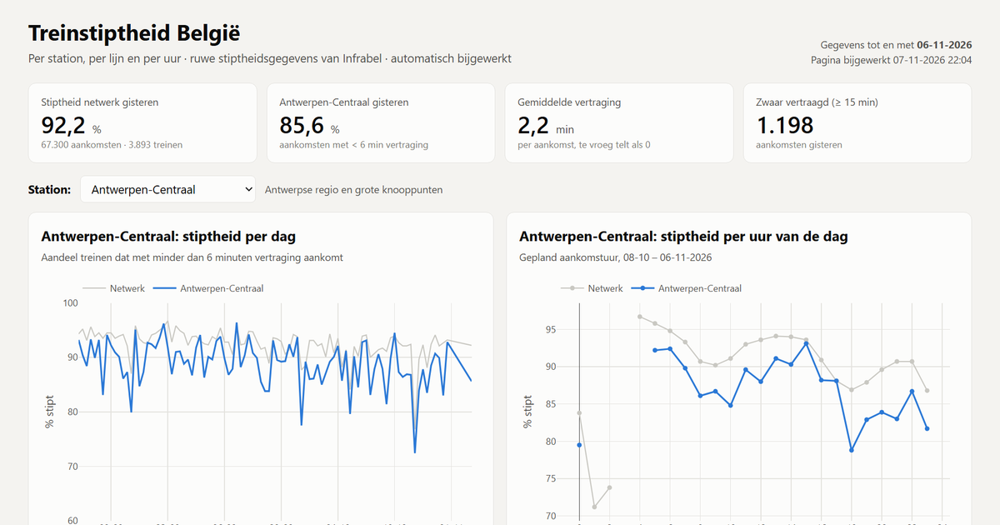

# Treinstiptheid België: per station, lijn en uur

**▶ Live dashboard: [badaninaanna.github.io/treinstiptheid-belgie](https://badaninaanna.github.io/treinstiptheid-belgie/)**

*Automatisch bijgewerkt met de ruwe stiptheidsgegevens van Infrabel: elke trein, aan elke stopplaats, elke dag.*

**Tools:** SQL (DuckDB) · Python · GitHub Actions · GitHub Pages · Plotly · open data (Infrabel, CC0)

---

## De vraag

Hoe stipt rijden de treinen in België, en waar zit het probleem? Welke stations, welke lijnen en welke uren
van de dag scoren het slechtst, en hoe evolueert dat? Met extra aandacht voor de Antwerpse regio.

## Belangrijkste resultaten

Op basis van **5,6 miljoen aankomsten** (augustus – november 2026). Een trein is stipt als hij met minder dan
6 minuten vertraging aankomt, zoals Infrabel het definieert.

| | Augustus | September | Oktober |
|---|---|---|---|
| Hele net | 93,8 % | 92,4 % | 91,0 % |
| Antwerpen-Centraal | 90,1 % | 88,9 % | 87,1 % |
| Antwerpen-Berchem | 92,2 % | 91,1 % | 89,9 % |
| Brussel-Zuid | 91,5 % | 89,0 % | 86,4 % |

- **De stiptheid zakt met de herfst:** van 93,8 % in augustus naar 91,0 % in oktober; het aantal zwaar vertraagde
  aankomsten (≥ 15 min) stijgt met 39 %.
- **Antwerpen-Centraal scoort structureel 3 à 4 procentpunt onder het net.** Het slechtste uur is 18 u
  (78,8 % stipt): wie in de avondspits in Antwerpen aankomt, heeft bijna één kans op vijf op een vertraging van 6 minuten of meer.
- **Internationale treinen zijn het minst stipt:** European Sleeper (25 %), Eurostar (62 %) en ICE (71 %),
  tegenover meer dan 90 % voor de meeste binnenlandse lijnen.
- **Oorzaken volgens Infrabel** (laatste 12 maanden): NMBS 39 %, derden 24 %, robuustheid van het systeem 17 %,
  Infrabel 15 %.



## Validatie tegen de officiële cijfers

Ik bereken de stiptheid zelf uit de ruwe gegevens en vergelijk het resultaat per station en per maand met de
officiële maandstiptheid die Infrabel publiceert:

| Maand | Stations | Mediaan absoluut verschil | Correlatie | Metingen t.o.v. officieel |
|---|---|---|---|---|
| Augustus 2026 | 558 | 0,36 pp | 0,81 | +11 % |
| September 2026 | 555 | 0,37 pp | 0,86 | +10 % |
| Oktober 2026 | 554 | 0,49 pp | 0,87 | +16 % |

Een eerste versie telde ook de vertrekken aan de beginhalte mee. Dat gaf 50 % meer metingen en een te gunstig
beeld voor eindstations (Antwerpen-Centraal 92,5 % tegenover officieel 90,9 %). Infrabel meet bij **aankomst**;
na die correctie ligt het verschil voor de helft van de stations onder een halve procentpunt.

## Hoe het werkt

```
Infrabel open data ──(geplande GitHub Actions)──► pijplijn.py ──► DuckDB-SQL ──► data/dag/*.csv
   ruwe gegevens D-1                                                    │
   maandarchieven                                        dashboard.py ◄─┘──► docs/index.html ──► GitHub Pages
   officiële maandcijfers
```

1. **Ophalen.** Een geplande workflow haalt meerdere keren per dag de ruwe gegevens van gisteren op (± 75 000 rijen),
   plus de officiële maandcijfers per stopplaats en de vertragingsoorzaken. Infrabel bewaart de dagbestanden maar
   één dag; verschijnt er een nieuw maandarchief (± 350 MB), dan vult de pijplijn ontbrekende dagen daaruit aan.
2. **Transformeren in SQL.** DuckDB normaliseert twee verschillende bronformaten (dagbestand en archief) naar één
   tabel, filtert op officiële stopplaatsen en berekent de kerncijfers per dag, per station, per lijn en per uur:
   [`sql/`](sql/).
3. **Bewaren.** Alleen de samenvattingen gaan in git (één CSV per tabel per maand); de ruwe gegevens blijven bij
   Infrabel beschikbaar. De verwerking is idempotent: een dag opnieuw verwerken vervangt de vorige versie.
4. **Publiceren.** Een statische webpagina met interactieve grafieken (Plotly) via GitHub Pages.

### De SQL

| Bestand | Wat |
|---|---|
| [`01_haltes_d1.sql`](sql/01_haltes_d1.sql) | dagbestand (puntkomma, kleine letters) → tabel `haltes` |
| [`01_haltes_archief.sql`](sql/01_haltes_archief.sql) | maandarchief (komma, hoofdletters, datums als `01SEP2026`) → dezelfde tabel |
| [`02_metingen.sql`](sql/02_metingen.sql) | join met de officiële stopplaatsen, stiptheidsdefinitie (aankomst < 360 s) |
| [`03_aggregaten.sql`](sql/03_aggregaten.sql) | kerncijfers per dag: net, station, lijn, uur (`FILTER`, `quantile_cont`, `UNION ALL`) |

## Projectstructuur

```
├── .github/workflows/bijwerken.yml   # geplande workflow
├── sql/                              # transformaties in DuckDB-SQL
├── src/
│   ├── pijplijn.py                   # ophalen, SQL uitvoeren, bewaren, archief aanvullen
│   ├── dashboard.py                  # bouwt docs/index.html
│   └── sjabloon.html                 # HTML/JS-sjabloon
├── data/
│   ├── dag/{dag_nationaal,dag_station,dag_relatie,dag_uur}/JJJJ-MM.csv
│   ├── officieel/                    # officiële maandstiptheid per stopplaats, oorzaken
│   └── stations.csv                  # stopplaatsen met coördinaten
└── docs/index.html                   # het gepubliceerde dashboard
```

## Zelf uitvoeren

```bash
python -m venv .venv
.venv\Scripts\activate
pip install -r requirements.txt
python src/pijplijn.py --archief-vanaf 2026-08   # eenmalig: ook de maandarchieven verwerken
python src/dashboard.py
```

## Bron en voorbehoud

Gegevens: [Infrabel open data](https://opendata.infrabel.be), licentie CC0. Afgeschafte treinen zitten niet in de
ruwe gegevens en tellen dus niet mee. Dit dashboard is een persoonlijk portfolioproject, geen officiële bron.
